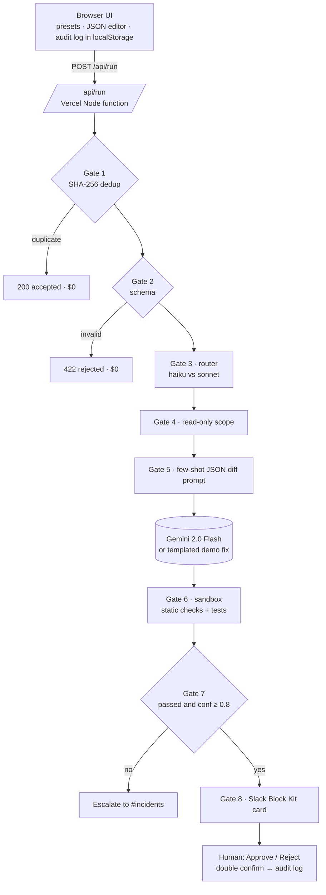

# Agent Guardrails Playground

> Send a production alert and watch an AI incident agent's patch fight through **8 guardrail gates** (dedupe, schema, model router, read-only scope, diff format, sandbox, confidence, Slack approval) before a human ships it.

**Live demo:** https://agent-guardrails-playground.vercel.app

This is the interactive, runnable twin of my n8n template **[AI Incident Agent · 8 Guardrail Gates](https://github.com/saitarun29work-cmd/x-media/tree/main/templates/ai-agent-8-gates)**. Same gates, same thresholds, same Slack copy, so what you see here is what you get when you import the workflow.


---

## Problem

Teams want AI agents on call: read the alert, find the bug, propose the fix. What stops them is trust. An unguarded agent will:

- burn tokens on every duplicate in an alert storm,
- choke on half-formed payloads from monitoring tools,
- use the most expensive model for a one-line null check,
- ask for write access it should never have,
- return prose instead of a patch you can test,
- propose something "confident" that drops a production column.

## Solution

Put the model in a box with eight gates around it. The model **never writes**: it proposes a unified diff with read-only tools. Code decides whether that diff is worth a human's time, and a human makes the final call in Slack with a double confirm.

| # | Gate | Rule (identical to the n8n template) | What it stops |
|---|------|--------------------------------------|---------------|
| 1 | **Webhook Dedup** | Same `alert_id` (SHA-256 hashed here) within 10 minutes is dropped | Alert storms burning tokens |
| 2 | **Schema Gate** | `alert_id`, `service`, `error`, `repo` required, else **422** | Bad input reaching the model |
| 3 | **Model Router** | `severity: critical` or error > 800 chars → `claude-sonnet-4-5`, else `claude-haiku-4-5` | Paying for the strong model by default |
| 4 | **MCP Read Scope** | Allowlist `git.blame:read`, `git.log:read`, `logs.search:read`; anything else denied | Write, deploy, or migrate access |
| 5 | **Few-Shot Diff Format** | Prompt carries a diff example; output must be strict JSON `{diagnosis, patch, confidence}` | Unparseable, untestable output |
| 6 | **Sandbox Verify** | Patch applied and tested (60s budget) | Untested code reaching a reviewer |
| 7 | **Confidence Gate** | Continue only if tests passed **and** confidence ≥ 0.8, else escalate | Unsure fixes sneaking through |
| 8 | **Slack Approval** | Block Kit card in `#incidents`, Approve / Reject with double confirm | Anything shipping without a person |

## Business impact (typical / estimated)

These are planning estimates for a team handling a few hundred alerts a month, not measured results:

- **Alert storms cost one model call, not twenty.** Every repeat inside the 10-minute window, and every malformed payload, stops at Gates 1–2 for $0.
- **~67% lower cost per routed incident** on the fast tier (Haiku vs Sonnet list prices), with the strong model reserved for critical or long traces.
- **Minutes, not hours, to a reviewable fix** for routine bugs (null checks, SSR guards), because the reviewer receives a tested diff instead of a stack trace.
- **Zero autonomous writes.** Every change has an audit row: who approved it, which model, what confidence, what it cost.

---

## Architecture



## Features

- **5 one-click presets:** a simple null-pointer fix (passes all 8), a duplicate alert (blocked at Gate 1), a malformed payload (422 at Gate 2), a risky production DB change (sandbox fails, escalated at Gate 7), and a long SSR stack trace (routed to the strong model by length).
- **Editable JSON** with live validation. Break it on purpose and Gate 2 rejects it.
- **Real gate logic, not a slideshow:** SHA-256 dedup (per-session in-memory store on the function instance plus client-side history), real schema validation, rule-based router, scope allowlist, unified-diff parser, destructive-SQL / migration / secret scanner.
- **Animated vertical pipeline:** gates resolve one by one with real per-gate timings; a block stops the run with the red reason and greys out the rest.
- **Cost per run** and the **model chosen**, with savings versus always using the strong model.
- **Slack Block Kit-style approval card** with Approve / Reject and a double confirm, mirroring `approvalType: double` in the n8n node.
- **Audit log table** (localStorage) of every run, block, escalation and decision, exportable as CSV.
- **Live AI or Demo mode badge.** Fully usable without any API key.

## How it works

1. The browser sends the raw webhook body, a random session id, and its recent dedupe hashes to `POST /api/run`.
2. `api/run.js` runs the gates in `api/_gates.js` in order. Each returns `{ id, name, status: pass | block | fail | skip, ms, detail, data }`.
3. Between Gate 5 and Gate 6 the fix is generated:
   - **Live:** with `GEMINI_API_KEY` set, Gemini 2.0 Flash is called with the Gate 5 few-shot prompt and `responseMimeType: application/json`.
   - **Demo:** `api/_demo.js` returns a templated fix for the incident class (null access, SSR, database, unknown). Same JSON contract, so every gate still runs.
4. Gate 6 inspects the diff (well-formed hunks, size, destructive SQL, schema migrations, secrets) and simulates the test run. In the n8n template this is your real `SANDBOX_URL`.
5. Cost is estimated from token counts at the routed model's list price (Sonnet 4.5 $3 / $15, Haiku 4.5 $1 / $5 per 1M tokens in / out). In live mode the actual Gemini cost is shown as well.
6. The UI animates the result, renders the Slack card or the escalation, and writes the audit row.

## Tech stack

- Static `index.html` + `assets/style.css` + `assets/app.js` (vanilla ES modules, no build step)
- Vercel Node serverless functions in `api/` (ESM, zero dependencies, Node 18+ `fetch` and `crypto`)
- Google Gemini REST API (optional)
- Inter + JetBrains Mono from Google Fonts

```
.
├── index.html
├── assets/        style.css · app.js
├── api/           run.js · status.js · _gates.js · _demo.js
├── n8n/           ai-agent-8-gates.n8n.json
├── docs/          screenshot.png
└── package.json · vercel.json · LICENSE
```

## Run locally

```bash
git clone https://github.com/Saitarun29/agent-guardrails-playground
cd agent-guardrails-playground
npx vercel dev          # http://localhost:3000, demo mode
# live mode:
GEMINI_API_KEY=your_key npx vercel dev
```

## Deploy

[](https://vercel.com/new/clone?repository-url=https://github.com/Saitarun29/agent-guardrails-playground&env=GEMINI_API_KEY)

Zero config. Leave `GEMINI_API_KEY` empty to ship in demo mode.

## Environment variables

| Variable | Required | Purpose |
|----------|----------|---------|
| `GEMINI_API_KEY` | No | Enables live fix generation with Gemini 2.0 Flash. Without it (or if the call fails) the app returns `mode: "demo"`. Never sent to the browser. |

Guards: payload capped at 16,000 characters, 30 runs per minute per IP per instance, POST only, 20s model timeout.

## n8n workflow

The production version of this demo is an importable n8n workflow: **[`n8n/ai-agent-8-gates.n8n.json`](n8n/ai-agent-8-gates.n8n.json)** (also published with full docs at [x-media/templates/ai-agent-8-gates](https://github.com/saitarun29work-cmd/x-media/tree/main/templates/ai-agent-8-gates)).

1. n8n → *Workflows → Import from File* → pick the JSON.
2. Set `ANTHROPIC_API_KEY` and `SANDBOX_URL` (your sandbox receives `{ repo, patch, run: "tests" }` and returns `{ "passed": true | false }`).
3. Connect Slack credentials on *Gate 8 · Slack Approval* and *Escalate to Human*.
4. Activate and `POST` an alert to `/webhook/agent-alert`.

The file has no credentials or keys; it reads everything from `$env`. The only change from the published template is an added sticky note explaining the flow.

| Playground | n8n template |
|------------|--------------|
| Gemini 2.0 Flash (live) or templated fix (demo) | Claude via `api.anthropic.com` (model picked by Gate 3) |
| Simulated sandbox: static diff checks + test run | Your `SANDBOX_URL` running the real test suite |
| Approval card in the browser, audit in localStorage | Slack `sendAndWait` with double approval |
| Per-session in-memory dedup + client history | Workflow static data (move to Redis for queue mode) |

## Roadmap

- Pluggable sandbox: call a real `SANDBOX_URL` from the playground when configured
- Shared audit log (Postgres / Sheets) and a weekly "gates saved you $X" digest
- Rate-limit and retry budget gate around the model call
- Per-repo policy file for allowed tools, paths and confidence thresholds
- Claude / OpenAI executors alongside Gemini

## Author

**Sai Tarun Ronanki** · AI Systems & Agentic Workflows Builder · Hyderabad

- Site: [saitarun.com](https://saitarun.com)
- LinkedIn: [ronanki-sai-tarun](https://linkedin.com/in/ronanki-sai-tarun)
- X: [@SaiTarunRonanki](https://x.com/SaiTarunRonanki)
- Instagram: [@tarunaistudio](https://instagram.com/tarunaistudio)
- Email: [hello@saitarun.com](mailto:hello@saitarun.com)
- **[Discuss your workflow on WhatsApp](https://wa.me/918008941430?text=Hello%20Sai%20Tarun%20Ronanki,%20I%20want%20to%20discuss%20about%20my%20workflow)**

MIT © 2026 Sai Tarun Ronanki
