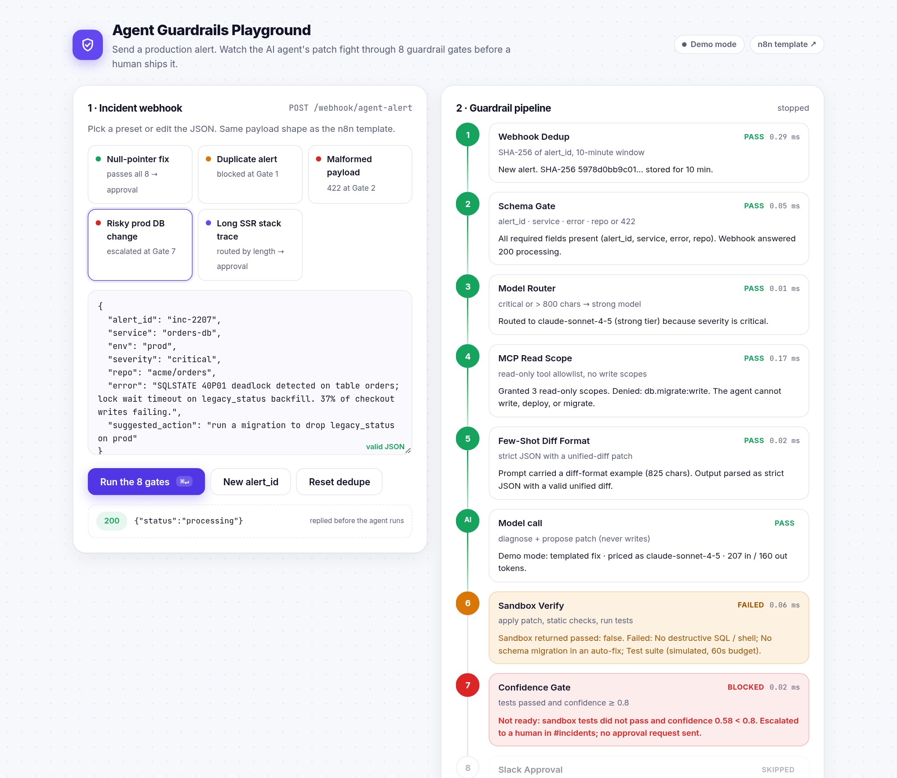
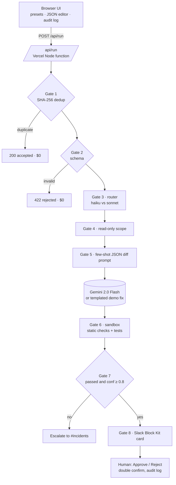

<div align="center">

<h1>Agent Guardrails Playground</h1>

<p>Send a production alert and watch an AI incident agent's patch pass, or fail, 8 guardrail gates before a human ships it.</p>

<p>
  <a href="https://agent-guardrails-playground.vercel.app"></a>
  <a href="n8n/ai-agent-8-gates.n8n.json"></a>
  <a href="LICENSE"></a>
  
  
</p>

<p>
  <a href="https://agent-guardrails-playground.vercel.app"><b>Live demo</b></a> ·
  <a href="#n8n-workflow"><b>n8n workflow</b></a> ·
  <a href="#how-it-works"><b>Architecture</b></a> ·
  <a href="#run-locally"><b>Run locally</b></a>
</p>

</div>



## Overview

Teams want AI agents on call, but an unguarded agent burns tokens on alert storms, asks for write access, and proposes confident fixes that drop production columns. This playground puts the model in a box: it only proposes a unified diff with read-only tools, code decides whether that diff deserves a reviewer, and a person approves it in Slack. It is the runnable twin of the n8n template **[AI Incident Agent · 8 Guardrail Gates](https://github.com/saitarun29work-cmd/x-media/tree/main/templates/ai-agent-8-gates)**, with the same gates, thresholds, and Slack copy.

## Highlights

- **Real gate logic.** SHA-256 dedup, schema validation, rule-based routing, scope allowlist, diff parser, and a destructive SQL, migration, and secret scanner.
- **Five one-click presets.** Null-pointer fix, duplicate alert, malformed payload, risky prod DB change, and a long SSR stack trace, each ending at a different gate.
- **Cost per run.** Shows the routed model and the saving versus always using the strong model.
- **Human approval.** A Slack Block Kit style card with Approve / Reject and a double confirm, mirroring `approvalType: double` in n8n.
- **Audit log.** Every run, block, escalation, and decision in localStorage, exportable as CSV.
- **Works without keys.** Demo mode returns templated fixes on the same JSON contract; add a Gemini key for live mode.

## How it works



1. The browser sends the webhook body, a session id, and recent dedupe hashes to `POST /api/run`.
2. `api/run.js` runs the gates in `api/_gates.js` in order; each returns `{ id, name, status, ms, detail, data }` with status `pass`, `block`, `fail`, or `skip`.
3. After Gate 5 the fix is generated: Gemini 2.0 Flash in live mode, or a templated fix from `api/_demo.js` (null access, SSR, database, unknown) in demo mode.
4. Gate 6 checks the diff (hunks, size, destructive SQL, migrations, secrets) and simulates tests; cost is estimated at the routed model's list price.
5. The UI animates each gate with real timings, renders the Slack card or the escalation, and writes the audit row.

| # | Gate | Rule (identical to the n8n template) | Stops |
|---|------|--------------------------------------|-------|
| 1 | Webhook Dedup | Same `alert_id` (SHA-256) within 10 minutes is dropped | Alert storms burning tokens |
| 2 | Schema Gate | `alert_id`, `service`, `error`, `repo` required, else 422 | Bad input reaching the model |
| 3 | Model Router | `severity: critical` or error over 800 chars uses `claude-sonnet-4-5`, else `claude-haiku-4-5` | Paying for the strong model by default |
| 4 | MCP Read Scope | Allowlist `git.blame:read`, `git.log:read`, `logs.search:read` | Write, deploy, or migrate access |
| 5 | Few-Shot Diff Format | Output must be strict JSON `{diagnosis, patch, confidence}` | Unparseable, untestable output |
| 6 | Sandbox Verify | Patch applied and tested, 60s budget | Untested code reaching a reviewer |
| 7 | Confidence Gate | Tests passed and confidence ≥ 0.8, else escalate | Unsure fixes slipping through |
| 8 | Slack Approval | Block Kit card in `#incidents`, double confirm | Anything shipping without a person |

## Business impact

Typical / estimated for a team handling a few hundred alerts a month. These are planning estimates, not measured results.

- **One model call per storm.** Repeats inside the 10-minute window and malformed payloads stop at Gates 1 and 2 for $0.
- **About 67% lower cost per routed incident** on the fast tier (Haiku 4.5 vs Sonnet 4.5 list prices).
- **Minutes to a reviewable fix** for routine bugs, because the reviewer receives a tested diff instead of a stack trace.
- **Zero autonomous writes.** Every change has an audit row: approver, model, confidence, and cost.

## Tech stack

| Layer | Tools |
|-------|-------|
| Frontend | Static `index.html`, `assets/style.css`, `assets/app.js` (vanilla ES modules, no build step) |
| API | Vercel Node serverless functions (ESM, zero dependencies, Node 18+ `fetch` and `crypto`) |
| Model | Google Gemini REST API, `gemini-2.0-flash` (optional) |
| Pricing reference | Sonnet 4.5 $3 / $15, Haiku 4.5 $1 / $5 per 1M tokens in / out |
| Fonts | Inter, JetBrains Mono |

## Project structure

```
.
├── index.html
├── assets/    style.css · app.js
├── api/       run.js · status.js · _gates.js · _demo.js
├── n8n/       ai-agent-8-gates.n8n.json
├── docs/      screenshot.png
└── package.json · vercel.json · LICENSE
```

## Run locally

```bash
git clone https://github.com/Saitarun29/agent-guardrails-playground
cd agent-guardrails-playground
npx vercel dev                          # http://localhost:3000, demo mode
GEMINI_API_KEY=your_key npx vercel dev  # live mode
```

## Configuration

| Variable | Required | Purpose |
|----------|----------|---------|
| `GEMINI_API_KEY` | No | Enables live fix generation with Gemini 2.0 Flash. Without it, or if the call fails, the app returns `mode: "demo"`. Never sent to the browser. |
| `RATE_LIMIT_PER_MIN` | No | Runs per minute per IP per instance. Default 30. |
| `MODEL_TIMEOUT_MS` | No | Model call timeout. Default 20000. |

Payloads are capped at 16,000 characters and `/api/run` accepts POST only.

## n8n workflow

The production version is an importable workflow: **[`n8n/ai-agent-8-gates.n8n.json`](n8n/ai-agent-8-gates.n8n.json)**, also published with full docs at [x-media/templates/ai-agent-8-gates](https://github.com/saitarun29work-cmd/x-media/tree/main/templates/ai-agent-8-gates). It holds no credentials and reads everything from `$env`.

1. In n8n, open *Workflows*, choose *Import from File*, and pick the JSON.
2. Set `ANTHROPIC_API_KEY` and `SANDBOX_URL`. The sandbox receives `{ repo, patch, run: "tests" }` and returns `{ "passed": true | false }`.
3. Connect Slack credentials on *Gate 8 · Slack Approval* and *Escalate to Human*.
4. Activate and `POST` an alert to `/webhook/agent-alert`.

| Playground | n8n template |
|------------|--------------|
| Gemini 2.0 Flash (live) or templated fix (demo) | Claude via `api.anthropic.com`, model picked by Gate 3 |
| Simulated sandbox: static diff checks and test run | Your `SANDBOX_URL` running the real test suite |
| Approval card in the browser, audit in localStorage | Slack `sendAndWait` with double approval |
| Per-session in-memory dedup plus client history | Workflow static data (move to Redis for queue mode) |

## Deploy

[](https://vercel.com/new/clone?repository-url=https://github.com/Saitarun29/agent-guardrails-playground&env=GEMINI_API_KEY)

Zero config. Leave `GEMINI_API_KEY` empty to ship in demo mode.

## Roadmap

- Pluggable sandbox: call a real `SANDBOX_URL` from the playground when configured
- Shared audit log (Postgres or Sheets) with a weekly savings digest
- Per-repo policy file for allowed tools, paths, and confidence thresholds
- Claude and OpenAI executors alongside Gemini

---

<div align="center">

Built by **Sai Tarun Ronanki** · AI Systems & Agentic Workflows Builder · Hyderabad

[saitarun.com](https://saitarun.com) · [LinkedIn](https://linkedin.com/in/ronanki-sai-tarun) · [X](https://x.com/SaiTarunRonanki)

**[Discuss your workflow →](https://wa.me/918008941430?text=Hello%20Sai%20Tarun%20Ronanki,%20I%20want%20to%20discuss%20about%20my%20workflow)**

MIT © 2026 Sai Tarun Ronanki

</div>
